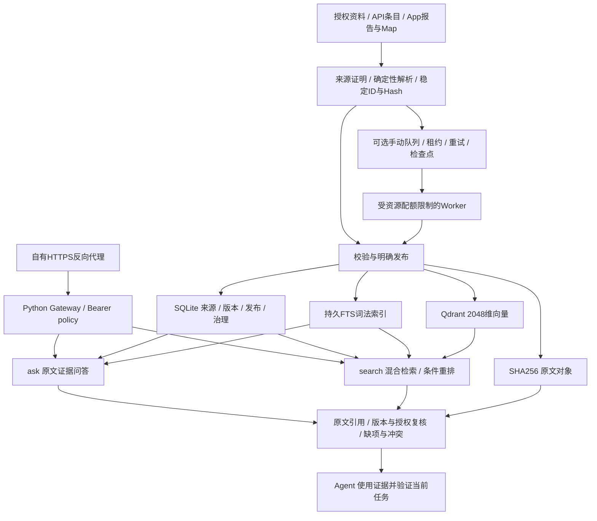

# AI 知识库

面向技术团队与 Agent 的单节点 Python 知识服务，支持公共库、API 专属库和 App 专属库，提供项目范围授权、版本化入库、混合检索及带引用的证据问答。


## 阅读导航

- [架构与数据流](#总体架构与数据流)：三层职责、入库、存储和读取链路。
- [接口与使用方式](#接口与使用方式)：公共/API/App 查询、引用及拒答状态。
- [评测结果](#评测结果与指标含义)：API 重排试点、双路径配对评测及失败边界。
- [完整架构设计](docs/architecture.md)：版本治理、权限开库、队列、恢复与后续优先级。
- [详细评测报告](docs/evaluation.md)：样本、公式、分母、失败、延迟统计与验收边界。
- [部署说明](deployment/README.md)：配置示例、服务准备和人工 Worker。

## 目标与能力范围

知识服务负责为 Agent 提供能回溯来源和版本的资料，减少重复查找、拼接上下文与复用历史经验的成本。测试执行、业务审批和当前结果核验由调用方完成。

| 知识域 | 内容 | 调用与隔离 |
|---|---|---|
| 公共 `common` | 已获授权的产品、研发、测试与流程资料 | 公共读凭证按可信策略访问；写入由管理员校验和明确发布 |
| API `test_api` | 接口用例、参数依赖、环境配置、测试集、历史失败/成功经验 | 按 domain/project/action 授权，保留原 metadata 与验证语义 |
| App `app` | 页面规则 Map、HTML/ZIP 执行报告、运行与步骤上下文 | 项目范围隔离；截图仅关联同来源版本、同 run/step 的 URL |
| Web 与扩展 | Web 连接器、图谱关系、多跳推理与统一 MCP/SDK | 当前首版未完成，按需求和专项评测推进 |

公共与专属库共用服务底座，但维护各自注册表和授权范围。全域目录入口与项目入口可能引用同一批数据，不能视为独立物理库或重复累计内容。

## 总体架构与数据流



系统按“服务底座 → 知识内容域 → Agent/应用”三层组织。数据链和读取链共享来源、版本、发布与权限信息；图中的职责关系不代表文件系统、SQLite 和 Qdrant 之间已有分布式原子事务。

### 存储与组件选型

| 组件 | 当前实现 | 选择及边界 |
|---|---|---|
| HTTP 服务 | Python Gateway + 自有 HTTPS 反向代理 | 网关默认回环监听，外部调用经过 TLS；不公开底层存储 |
| 来源/版本/任务注册表 | 分库 SQLite WAL | 保存技术版本、发布、治理、审计与任务状态；共享单节点资源 |
| 原文与大型父对象 | SHA256 不可变文件对象 | 保留原文、报告、日志和引用；不是云对象存储 |
| 词法索引 | SQLite FTS | 可重建；历史存储片段数不等于当前可查询业务内容数 |
| 语义索引 | Qdrant，2048 维，回环访问 | 通过稳定点 ID 与来源版本关联，由原文和模型重建 |
| 模型 | 官方方舟 Embedding/视觉 API；条件 qwen3-rerank | 无本地 GPU；重排按库/project 配置，新增项目默认关闭 |
| 异步任务 | 持久队列 + 人工 oneshot Worker | 至少一次执行，稳定 ID/hash 幂等；不创建周期采集 |

首版没有新增 MySQL、Redis、OpenSearch、云对象存储、Neo4j 或独立高可用集群。

### 入库、治理与权限

1. 核验来源权限，解析并保留 source/version/hash；失败或缺席不被当作删除。
2. 公共来源由可信管理员明确发布；API 使用结构化条目校验；App 报告异步完成后切换发布，Map 保留页面规则与定位。
3. 手动队列使用 `schema_version/connector/source_id/version/request_id/payload` 固定信封，适配 `common_bundle/api_items/app_maps`。
4. 队列持久化事件与检查点，租约过期恢复、指数退避，最多 5 次失败。安全重试依赖幂等，不承诺跨存储 exactly-once。
5. 业务有效期、权威依据和替代关系由显式治理确认；历史默认 unknown，不按路径或文件日期自动认定新版本有效。
6. Bearer policy 决定域、项目和操作范围，filters 只能收窄授权。候选前筛与响应前复核共同限制输出。

`approved/business_verified` 要有真实权威引用，替代关系拒绝环。owner 仅描述负责人，不证明自然人独占。组织身份、源 ACL 实时联动和完整业务规则仍需要单独接入与验收。

## 架构与代码结构

| 模块 | 主要文件 | 职责 |
|---|---|---|
| 服务入口 | `prototype/gateway.py`、`access.py` | HTTP 路由、请求校验、查询配额及响应前授权复核 |
| 知识底座 | `prototype/core.py`、`storage.py`、`parser.py` | 来源与版本注册表、SHA256 原文对象、解析、发布及撤回 |
| API 专属库 | `prototype/api_library.py` | 结构化 API 知识入库、稳定 ID、哈希幂等和项目筛选 |
| App 专属库 | `prototype/app_library.py`、`app_reports.py`、`app_maps.py`、`app_jobs.py` | HTML/ZIP 报告、Map、运行与步骤上下文；截图保留 URL 引用 |
| 混合检索 | `prototype/app_search.py`、`retrieval.py`、`rerank.py` | 词法、精确与向量召回，RRF 融合和可选重排 |
| 证据问答 | `prototype/evidence_qa.py` | 授权范围内 FTS 查询、关联章节、原文摘录、引用、冲突提示及拒答 |
| 业务治理 | `prototype/governance.py` | 有效期、权威依据、替代关系与审计；历史业务有效性默认未知 |
| 手动入库队列 | `prototype/connector_queue.py` | 持久任务、租约恢复、重试与检查点；支持公共/API/App 适配器 |
| 权限与开库 | `prototype/authorization.py`、`library_routes.py`、`library_operator.py` | 凭证策略、库目录发现和受控自助开库 |
| 运维 | `prototype/architecture_ops.py`、`backup.py`、`diagnostics.py` | 校验和备份、隔离恢复、文本向量重建、只读 GC 计划与追踪 |
| 模型接入 | `integration/` | 火山方舟 Embedding 与视觉模型适配器及验证 |
| 部署与客户端 | `deployment/` | 配置示例、手动 Worker 服务配置和 App 报告客户端 |

各库使用 SQLite WAL 注册表、文件系统原文对象、FTS 词法索引与回环地址 Qdrant 向量库，共享单节点物理资源。独立查询槽与 Worker 配额不代表独立基础设施隔离。

## 两条查询路径

- `POST /search`：保留词法、精确与向量混合召回，按配置启用重排，适合语义检索与证据查找。
- `POST /ask`：使用 FTS 和来源上下文返回带引用的原文摘录，不调用 Embedding、向量查询、重排或生成模型。

`/ask` 当前不覆盖图片派生问答、完整跨文档推理或生成式总结。找到证据不等于业务规则完整、当前版本有效或测试执行通过；消费 Agent 需要核验引用、版本与当前任务。

Web 连接器尚未实现。未部署本地 GPU 模型。

## 接口与使用方式

| 入口 | 用途 | 说明 |
|---|---|---|
| `GET /health` | 服务存活检查 | 不证明数据质量或模型可用 |
| `GET /auth/me` | 当前凭证身份与授权范围 | 用于核对授权 |
| `GET /libraries` | 可见库目录 | 返回当前凭证可查询/可维护的入口 |
| `POST /libraries` | 受控自助开库 | 固定 Unix socket operator，配对读写凭证保存在私密台账 |
| `POST /search` | 混合召回与条件重排 | 按 `filters.kb_domain/project` 路由 |
| `POST /ask` | 快速原文证据问答 | 同样受域/project 权限限制 |
| `POST /imports/api/items`、`/upsert` | API 结构化条目入库 | 稳定 ID/hash，按实际写权限校验 |
| `POST /imports/app`、`/imports/app/packages` | HTML/ZIP 报告异步导入 | 仅允许精确白名单中的报告来源 |
| `POST /imports/app/maps` | Map 导入 | 保留项目与页面规则 |
| `GET /imports/{job_id}` | 报告任务状态 | 任务读取仍执行授权检查 |

### 查询示例

部署方先在进程环境中配置自己的 `KB_BASE_URL` 和已授权的 `KB_READ_TOKEN`，不要将实际凭证写进仓库。以下是请求格式示例，未包含真实项目或 Token。

```bash
curl "$KB_BASE_URL/ask" \
  -H "Authorization: Bearer $KB_READ_TOKEN" \
  -H 'Content-Type: application/json' \
  --data-binary '{"query":"示例功能的核心规则有哪些","top_k":5,"filters":{"kb_domain":"common"}}'
```

专属库按授权修改 filters：

```json
{"query":"示例接口的参数依赖","top_k":5,"filters":{"kb_domain":"test_api","project":"example_api"}}
```

```json
{"query":"示例页面的入口规则","top_k":5,"filters":{"kb_domain":"app","project":"example_app"}}
```

示例中的项目必须替换为实际获授权项目。需要语义混合检索时使用 `/search`；这不是扩大权限的方式。

### `/ask` 返回与预算

| 字段 | 含义 |
|---|---|
| `answer_mode=source_excerpt` | 当前是原文摘录，不是生成模型总结 |
| `answer_status=evidence_found` | 找到了证据，不代表完整规则或业务验收通过 |
| `answer_status=abstained`、`abstain_reason` | 缺少授权证据、主体证据不足或索引未就绪时说明原因 |
| `claims/citation_ids`、`evidence` | 摘录与引用绑定，可回溯 source/version/url |
| `governance/conflicts/warnings` | 业务有效性未知与未解决版本关系提示 |
| `coverage=partial_unverified` | 当前不承诺完整覆盖 |
| `retrieval_trace_id/stage_timings_ms` | 区分授权、候选、章节、引用与总耗时，辅助定位问题 |

`/ask` top_k 默认 5、范围 1–8；邻接章节可能使引用片段数超过 top_k。总证据预算 24000 字符，单证据最多 6000 字符，单条摘录最多 1500 字符。HTTP 401/403 是鉴权或范围拒绝；繁忙可返回 503 `qa_busy` 并建议退避。

## 评测结果与指标含义

以下是原部署环境在 2026-10-22 与 2026-10-26 的脱敏历史汇总，不是公开合成测试生成的分数。原业务语料和问题不公开；这些结果不构成当前生产准确率或 SLA。

### API 检索与重排试点

62 题包括 54 个正例、4 个空过滤问题和4个语义无答案问题。正例覆盖38个意图、部分成对改写；标签由语料衍生，未经业务负责人独立确认。同候选对照如下：

| 指标 | RRF | RRF + qwen3-rerank |
|---|---:|---:|
| Top1 命中率 | 74.07% | 90.74%（49/54） |
| Top5 命中率 | 90.74% | 92.59%（50/54） |
| Top5 结果精确率 | 51.48% | 54.44% |
| Top5 必需知识点覆盖率 | 90.74% | 92.59% |
| MRR@20 | 0.8279 | 0.9247 |
| nDCG@5 | 0.8022 | 0.8831 |

**92.59% 是“前5条至少命中一条目标”的比例；54.44% 是“前5条中有多少相关”的比例。两者都不是端到端业务答案准确率。** 重排使12题Top1改善、3题退步；语义无答案负例正确拒答为0/4。

API单请求40次的P50/P95为0.981/1.358秒，双并发40次为1.185/2.030秒。本轮151次HTTP均成功；这是限定场景小样本，不是持续容量或SLA。

### 公共 `/search` 与 `/ask` 配对评测

10题包括6个正例与4个负例，各路径每题一次。两路径算法及上下文预算不同；超时保留，不被诊断重试替换。

| 指标 | `/search` | `/ask` |
|---|---:|---:|
| HTTP 成功率 | 90%（9/10） | 90%（9/10） |
| 客户端超时 | 1次 | 1次 |
| 成功请求耗时中位数 | 6.851秒 | 0.331秒 |
| 成功正例项目路径相关性宏平均 | 78.33%（5题） | 100%（5题） |
| 核心功能清单命中 | 50%（1/2） | 100%（2/2） |
| 负例拒答率 | 0%（0/4） | 100%（4/4） |

新路径32条摘录均可定位返回原文（30完整行、2个截断前缀），只证明引用绑定与摘录一致。**100%项目路径相关性不代表业务规则正确，也不能替代API Top5精确率54.44%。** 4个负例拒答成功不证明通用语义拒答已充分校准。

新 `/ask` 省去模型/向量调用，不能把耗时差当同算法加速倍数。两条路径各有一次35秒客户端超时，根因未确证；10题不足以建立P95/P99。专属库另有API0.601秒、App2.494秒单次smoke，不能作为普遍性能承诺。

详细样本结构、统计定义、失败边界、回归与恢复验证见 [评测报告](docs/evaluation.md)。

## 运行配额、恢复与可观测性

- 原部署网关内存上限8GiB；旧search有2个查询槽，新ask有独立1槽。SQLite/Qdrant仍共享主机。
- 手动Worker为oneshot，CPU50%、内存1GiB、TasksMax32，不配置timer，也不脱离配额启动App后台导入。
- 日志记录安全trace ID、阶段耗时和异常类别，不记录凭证或正文；客户端HTTPS耗时与服务端检索耗时分开分析。
- 提供注册表/原文校验和备份、向新目录隔离恢复、稳定ID文本向量重建、保留历史引用的GC只读计划。
- 已做2个真实来源版本/2条文本向量的隔离恢复演练；不代表全量/离站灾备。图片向量重建和实际GC尚未完成。
- 备份前需停止相关写入，注册表与原文备份不自动包含Qdrant服务备份。历史保留周期和离站目标由部署方确认。

## 实施进度与下一步

| 优先级 | 已实现首版 | 尚未完成或待验收 |
|---|---|---|
| P0 知识质量 | 显式治理、授权FTS、引用、邻接章节、缺项拒答、冲突及追踪 | 权威版本补录、独立业务gold与阈值、同义改写和完整规则覆盖 |
| P1 稳定与恢复 | 独立ask槽、受限Worker、持久恢复与幂等、隔离恢复、文本重建和GC计划 | 偶发HTTP超时根因、宽App/混合并发/持续容量、全量及离站灾备 |
| P2 接入统一 | 公共/API/App固定信封和适配器、人工触发 | 真实Agent/负责人流水线更新回读闭环、Web连接器 |
| 后续扩展 | 保留接口与模块边界 | 派生图文问答、生成回答、CodeWiki关联、GraphRAG、MCP/SDK按需求评测后引入 |

下一阶段优先补齐“有效知识—正确证据—独立评测”的闭环。新模型或平台的引入需要题集证明收益；不自动恢复定时采集。

## 本地验证

要求 Python 3.11+，使用 Linux 或 macOS。部分服务依赖 `fcntl`，Linux 部署使用 systemd。

```bash
python3 -m venv .venv
. .venv/bin/activate
python -m pip install -r requirements.txt
PYTHONPATH=prototype:integration:deployment python -m unittest discover -s prototype -p 'test_*.py'
PYTHONPATH=prototype:integration:deployment python -m unittest discover -s integration -p 'test_*.py'
python tools/check_public_tree.py
```

测试使用合成数据及模拟模型/存储。依赖原始私有 HTML 报告的测试已在导出时剔除，并为图文步骤关联补充合成报告夹具；不要将真实报告复制到本仓库。

本地已通过 124 项服务测试与 5 项模型接入测试。示例名称进一步泛化后，39 项受影响测试再次通过；这部分与完整测试集重叠。模型配置示例已核对适配器字段，不触发真实网络调用。离线测试不代表生产性能或业务准确率验收。

`.github/workflows/check.yml` 会在 GitHub 上运行 Linux 离线检查，远端执行结果与本地验证分别记录。

`integration/smoke_ark.py` 是可选的真实供应商接口验证，需要自行配置凭证；它不属于自动离线测试。

## 部署方式

本仓库是可审查的实现导出，不是一键生产安装器。历史机器专用部署脚本、业务数据和运行快照均未包含。

详细配置见 [部署说明](deployment/README.md)。网关监听回环地址；需要部署自己的 HTTPS 反向代理、私密配置、Qdrant API Key、数据目录与授权策略。

App 报告入口仅允许占位来源 `https://reports.example.test/files/reports/`。接入真实报告服务时，应在 `prototype/app_jobs.py` 和 `deployment/app_kb_client.py` 中一致地替换精确白名单，不能改成允许任意 URL 的正则。

## 脱敏与运行边界

- 不包含公司文档、生产凭证、数据库快照、内部服务地址、真实报告附件或原项目 Git 历史。
- 配置示例仅保留字段名、通用路径和空凭证值。真实 `.env`、授权策略、凭证台账和运行对象不得提交。
- 示例网址使用保留的 `.test` 域名；官方模型供应商地址及回环地址按功能需要保留。
- 采集与队列均按人工触发使用，没有配置定时采集任务。
- GC 目前只生成计划，不执行删除；历史保留规则和离站恢复目标需要由部署方明确。
- 回滚到不支持 `qa_tokens` 的旧核心前，必须先移除 `qa_insert`、`qa_delete`、`qa_update` 触发器。
- 全量灾备、离站恢复、长期容量及独立业务评测仍需专项验收，不能由本仓库的测试结果代替。

本次导出未指定开源许可证。
