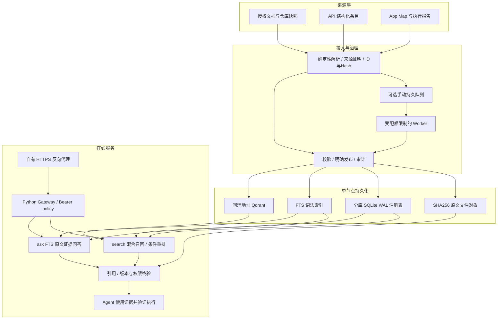
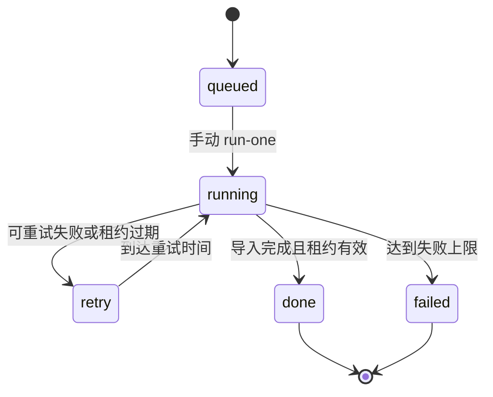

# 完整架构与设计边界

## 1. 三层组织

知识服务底座统一提供来源解析、权限、版本、存储、发布、检索、审计与运维。知识内容层组织公共与专属域。Agent/应用层按任务授权消费证据并调用自己的工具执行动作。

| 层次 | 当前职责 | 边界 |
|---|---|---|
| 服务底座 | HTTPS 网关、可信 policy、来源注册表、原文对象、FTS/Qdrant、手动队列、引用、治理、备份 | 单节点，不是独立高可用平台 |
| 公共域 `common` | 授权产品、研发、测试及流程资料 | 公共共享读凭证不具备普通 HTTP 写权限；入库由可信管理员校验与明确发布 |
| API 域 `test_api` | 用例、参数依赖、环境、测试集与历史执行经验 | 按项目授权；源 verified 状态不自动提升为当前执行通过 |
| App 域 `app` | 页面规则 Map 与 HTML/ZIP 执行报告 | 按项目授权；截图以 URL 与同 run/step 关联，App 不自动继承公共 OCR 能力 |
| Agent/应用 | 使用来源、版本与引用完成任务，再做业务/UI/执行核验 | 知识读权限与工具执行权限分离；owner 描述不证明自然人独占 |

CodeWiki 关联、完整组织身份交集、GraphRAG、多跳推理、统一 MCP/SDK 和 Web 连接器是后续目标，不因本仓库具备 HTTP 接口就被视为完整上线。

## 2. 总体数据流

图中是职责关系，不表示文件系统、SQLite 与 Qdrant 间存在分布式原子事务。当前通过来源/版本/发布对账、稳定 ID 与内容哈希、失败恢复，以及读取时过滤，限制不完整写入参与查询。

## 3. 入库与发布

### 公共来源

核验来源权限证明，确定性解析文档、标题、表格与引用，保留 source/version/hash。幂等复用后执行对账，由可信管理员明确批准发布。权限拒绝不绕过；采集失败或来源缺席不当作删除。

### API 条目

`/imports/api/items` 或兼容 `/upsert` 使用稳定条目 ID、原始正文和类型化 metadata。按 source/version/hash 幂等写入；长正文按行边界切分，保留原字段含义。使用已有导入锁，避免并发互相覆盖。

### App 报告与 Map

HTTP 报告路径为异步任务，完成解析与导入后切换发布。Map 导入保留页面、规则与定位信息。报告保留 batch/run/step/source/version、原始日志和人工评审状态；引用图只回填同来源版本、同运行、同一步的 before/after URL，不能从别的运行借图。

截图使用 links-only 存储，不自动下载原图。原 HTML、日志、父对象和历史 manifest 仍占磁盘，不能将 links-only 当作无存储成本。

### 统一队列

固定信封为 `schema_version=1, connector, source_id, version, request_id, payload`。支持 `common_bundle`、`api_items`、`app_maps`；未知/Web 适配器拒绝。

相同 request_id、相同内容复用；相同 request_id、不同内容冲突。持久 jobs/events/checkpoints、租约恢复与指数退避记录执行过程，最多 5 次失败。语义为至少一次执行，安全重试依赖稳定 ID 与哈希幂等，不承诺跨模型与跨存储 exactly-once。

队列 CLI 是可信本地管理员入口，不替代 HTTP 鉴权。公共适配器仍需来源证明与发布批准；API/App 复用现有校验与锁。App 队列导入在 oneshot 内同步完成，不脱离 Worker 配额启动后台子进程。

## 4. 数据与存储模型

| 数据 | 当前保存方式 | 用途 |
|---|---|---|
| 来源、技术版本 | 各域 SQLite `sources/versions` | 原文追溯、活动版本、撤回状态 |
| 发布记录 | SQLite `publications` | source/version/hash、发布范围与批准依据 |
| 原文与父对象 | SHA256 文件对象 | 保留原始资料、报告、日志和父子上下文 |
| 文本片段与索引 | SQLite `chunks` 与持久 FTS | 可重建的检索片段，索引可能包含历史 |
| 向量 | Qdrant，2048 维，回环地址访问 | 语义召回；点 ID 与来源版本稳定关联 |
| 业务治理 | SQLite 显式治理表 | 有效期、权威依据、文档族、替代关系、审计 |
| 导入与连接器进度 | 持久任务表、事件与检查点 | 幂等、失败恢复、执行记录 |
| 访问策略与凭证 | 私密 policy、凭证台账及私密配置 | 由服务器维护，不能由请求 filters 扩权 |

没有新增 MySQL、Redis、OpenSearch、云对象存储、Neo4j 或本地 GPU。文件对象不等于云对象存储；历史存储索引数不等于当前可检索业务内容数。

## 5. 业务版本治理

技术版本用于原文与发布一致性；业务适用版本需要显式确认。元数据包含 `family/module/doc_type/state/valid_from/valid_until/supersedes/authority_ref/knowledge_kind`，记录操作人及理由。

`approved` 或 `business_verified` 必须有权威引用；替代关系引用已登记版本并拒绝环。只有授权范围内、有效且已批准的后继版本才能抑制旧版。历史数据默认 unknown，不根据文件名日期自动确认最新规则。

路径推断仅用于候选分组与未确认冲突提示；导入成功、技术发布、业务审核、执行通过分别表达，不能共用一个成功标记。

## 6. 权限与自助开库

调用方使用 Bearer 凭证；可信 policy 指定 domain/project/action。请求 filters 只能收窄权限。查询前筛与响应前复核共同执行，避免权限变化后输出旧授权结果。

`GET /libraries` 仅返回当前凭证可访问的公共/专属入口。`POST /libraries` 通过受控 Unix socket operator 开库，配对读写凭证保存在私密台账和私密文件中；新项目默认关闭 rerank。

专属项目共用域存储，目录可能同时存在全域入口与项目入口，不能将其当独立物理库或重复计算内容。没有在此公开真实项目名、负责人、库目录或 Token。

治理、备份恢复和队列 CLI 仅供可信管理员，不直接开放给普通读凭证。复杂自然人/部门/组/源 ACL 联动、实时撤权传播仍需独立接入与验收。

## 7. 两条读取路径

### `/search`

范围与版本限定 → lexical/exact/dense → RRF → 条件 qwen3-rerank → 原文与父对象回填 → 同 run/step 图片 URL 关联 → 版本与权限终验。

App/API 已有 SQL 前置范围过滤与持久索引。公共旧 `/search` 仍存在全文加载路径，不能把专属域优化声明推广到所有域。重排只处理已授权候选，是否启用取决于库/project 配置；排名分数不是事实正确概率。

### `/ask`

授权与业务治理 → FTS 候选 → 已知主体约束、资料类型优先 → 文档族去重/冲突 → 同版本邻接章节 → 原文摘录与引用 → 缺项拒答和响应前复核。

top_k 默认 5、范围 1–8；邻接章节可能增加引用数。证据总预算 24000 字符、单证据 6000、单摘录 1500。

返回 `answer_mode=source_excerpt`、`answer_status`、`claims/citation_ids`、`evidence`、`governance`、`conflicts`、`warnings`、`abstain_reason`、`coverage=partial_unverified`、trace 与阶段耗时。`evidence_found` 不代表完整答案或已验收业务规则；主体证据不足可返回 abstained。

该路径不调用生成模型、Embedding、向量或重排，也未接入图片派生问答。主体约束为可解释词法规则，不等于充分校准的语义拒答。

## 8. 配额、观测与恢复

| 项目 | 当前配置/实现 | 尚未证明 |
|---|---|---|
| 旧 search 查询槽 | 2 个 | 持续峰值容量、跨用户公平性 |
| 新 ask 查询槽 | 独立 1 个；忙碌返回 qa_busy | 宽专属库稳定时延 |
| 网关 | 原部署内存上限 8 GiB | 全基础设施隔离/高可用 |
| 手动 Worker | CPU 50%、内存 1 GiB、TasksMax 32、oneshot | 大规模持续导入容量 |
| 日志 | 安全 trace ID、阶段耗时、异常类别；不记录凭证/正文 | 偶发 HTTP 超时根因 |
| 备份恢复 | 校验和注册表/原文备份、隔离新目录恢复 | 全量、离站与图片向量恢复 |
| 向量重建 | 稳定 ID 文本向量重建与对账 | 图片向量重建 |
| GC | 保留历史引用的只读计划 | 实际删除政策与保留周期 |

备份前需停止相关写入，注册表/原文备份不自动包含 Qdrant 服务备份。回滚旧 core 前必须移除依赖 `qa_tokens` 的三个 SQL 触发器。无 timer，不恢复定时采集。

## 9. 后续优先级

1. P0：负责人确认权威版本、替代关系与有效期；建立独立业务 gold 和阈值，验收完整规则与拒答。
2. P1：定位偶发 HTTP 超时，测试宽 App、混合并发与持续容量；明确离站目标后做完整灾备。
3. P2：负责人/Agent 的真实流水线接入手动统一队列，补更新与回读闭环。
4. 按实际需求和评测引入派生图文问答、生成回答、CodeWiki 关联、GraphRAG、MCP/SDK 与 Web，不预先写成已实现。

评测定义、结果、失败与验收边界见 [评测报告](evaluation.md)。
